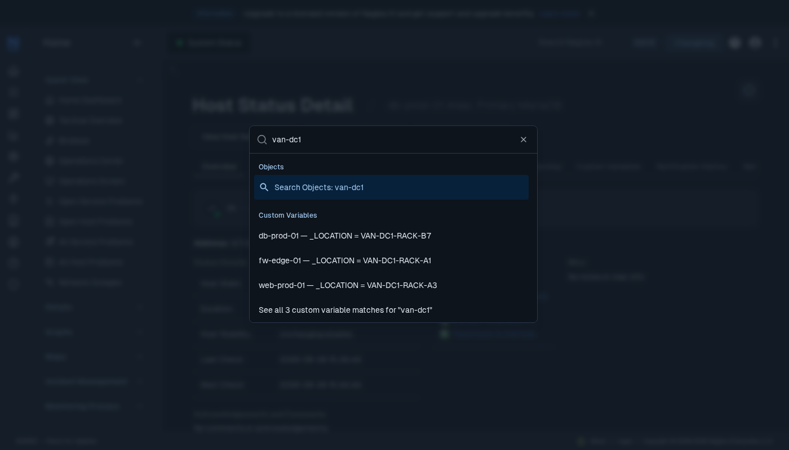
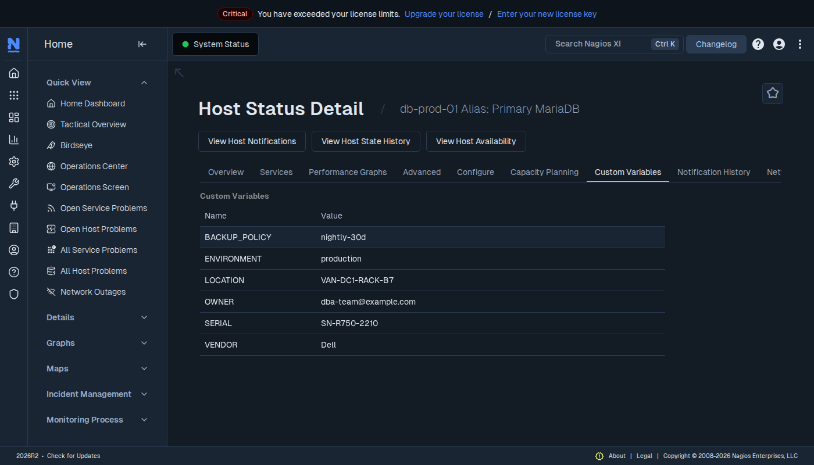
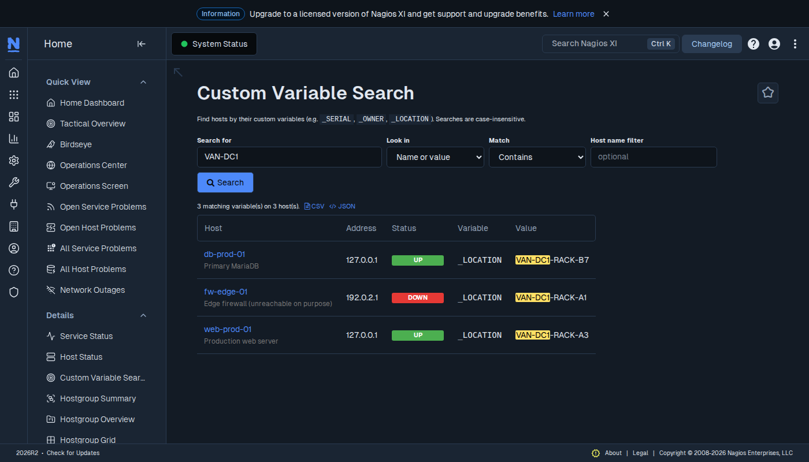

# Nagios XI – Custom Variable Search

A Nagios XI component that finds hosts by their **custom variables** (`_SERIAL`,
`_OWNER`, `_LOCATION`, `_VENDOR`, …), from a search page or straight from XI's global
search box. XI's built-in search only covers host and service names.



Selecting a result opens that host's **Custom Variables** tab:



The full search page (*Home → Details → Custom Variable Search*):



## Highlights

- Results in XI's **global search box** (Neptune Ctrl+K and the classic navbar search)
- Search page: name / value / both · contains / exact / regex · host filter · CSV & JSON export
- Respects XI permissions; masks and protects secret-looking variables (`*PASS*`, `*TOKEN*`, `*COMMUNITY*`, …)
- Includes template-inherited variables; no core XI files modified

**User documentation** – installation, usage, the JSON endpoint and the security model –
is in [`customvarsearch/README.md`](customvarsearch/README.md), which ships inside the
component. Release notes: [`customvarsearch/CHANGES.txt`](customvarsearch/CHANGES.txt).

## Install

Download [`customvarsearch.zip`](customvarsearch.zip), then in Nagios XI:
*Admin → Manage Components → Upload a Component*.

Tested on **Nagios XI 2026R2** / Ubuntu 24.04 / PHP 8.3 / MariaDB, Neptune and classic
(Modern) themes.

## Repository layout

| Path | Contents |
|---|---|
| `customvarsearch/` | The component (this directory is what the zip contains) |
| `customvarsearch.zip` | Installable package |
| `tests/` | PHP unit, JavaScript unit and live-XI integration tests – see [`tests/README.md`](tests/README.md) |
| `docker/Dockerfile` | Ubuntu 24.04 + systemd base image for a Nagios XI lab |
| `seed-demo-hosts.sh` | Creates the demo hosts and custom variables via the XI API |
| `demo/` | Headless-browser demo scripts, screenshots and a video |

Build the zip from the repository root:

```bash
python3 -c "import shutil; shutil.make_archive('customvarsearch', 'zip', '.', 'customvarsearch')"
```

## Tests

```bash
php tests/php/run_tests.php                      # 30 PHP unit tests
python3 tests/js/test_search_hook.py             # 19 browser tests of search-hook.js
XI_URL=... XI_ADMIN_PASS=... XI_VIEWER_PASS=... XI_CLASSIC_PASS=... \
    python3 tests/integration/test_live_xi.py    # 20 end-to-end tests on a live XI
```

See [`tests/README.md`](tests/README.md) for requirements and test data.

## Demo lab (Docker, Ubuntu 24.04)

`docker/Dockerfile` is an Ubuntu 24.04 image with systemd as PID 1, which the official XI
installer needs.

```bash
docker build -t nagiosxi-base:ubuntu24.04 docker/
docker run -d --name nagiosxi --hostname nagiosxi --privileged --cgroupns=host \
  -v /sys/fs/cgroup:/sys/fs/cgroup:rw --tmpfs /run --tmpfs /run/lock \
  -p 8080:80 -p 8443:443 nagiosxi-base:ubuntu24.04
docker exec nagiosxi bash -c 'cd /tmp && wget -q https://assets.nagios.com/downloads/nagiosxi/xi-latest.tar.gz \
  && tar xzf xi-latest.tar.gz && cd nagiosxi && ./fullinstall -n'
```

Then browse to `http://<host>:8080/nagiosxi/`, complete the 6-step setup wizard (it
requires registering a free Home Lab or trial license), upload the component, and create
the demo hosts:

```bash
XI_URL=http://localhost:8080 XI_KEY=<your api key> ./seed-demo-hosts.sh
```

`demo/demo.py` (search page) and `demo/demo_search.py` (global search) are the headless
Playwright scripts that produced the screenshots and `demo/customvarsearch-demo.webm`;
`demo/xi.py` holds shared helpers and `demo/install.py` uploads the zip.

## License

[MIT](LICENSE) – Copyright (c) 2026 James Seldon.

## Demo results

| Search | Result |
|---|---|
| `dell` (contains, name or value) | app-stage-01, db-prod-01 (`_VENDOR`) |
| `^SN-R[0-9]+` (regex, value only) | app-stage-01, db-prod-01 (`_SERIAL`) |
| `VAN-DC1` | db-prod-01, fw-edge-01 (DOWN), web-prod-01 (`_LOCATION`) |
| `contract` (variable name only) | fw-edge-01 `_SUPPORT_CONTRACT` |
| `production` (exact) + host filter `prod` | db-prod-01, web-prod-01 |
| `[unclosed` (regex) | "Invalid regular expression." |
| `example.com` as **nagiosadmin** | every host with an `_OWNER` |
| `example.com` as limited user **viewer** | only web-prod-01 (the one host they're a contact for) |
